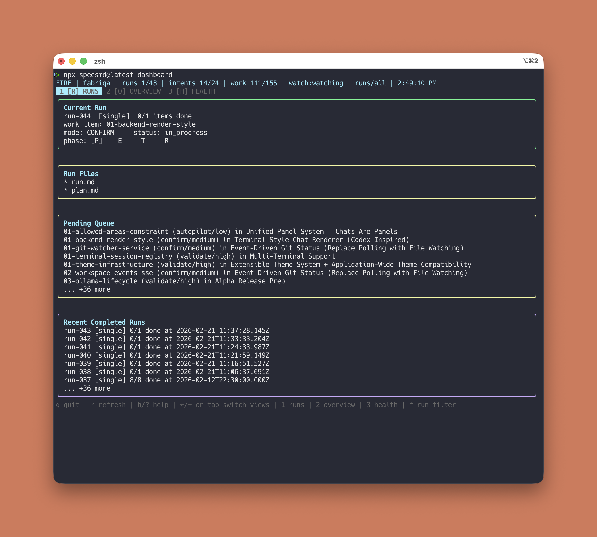
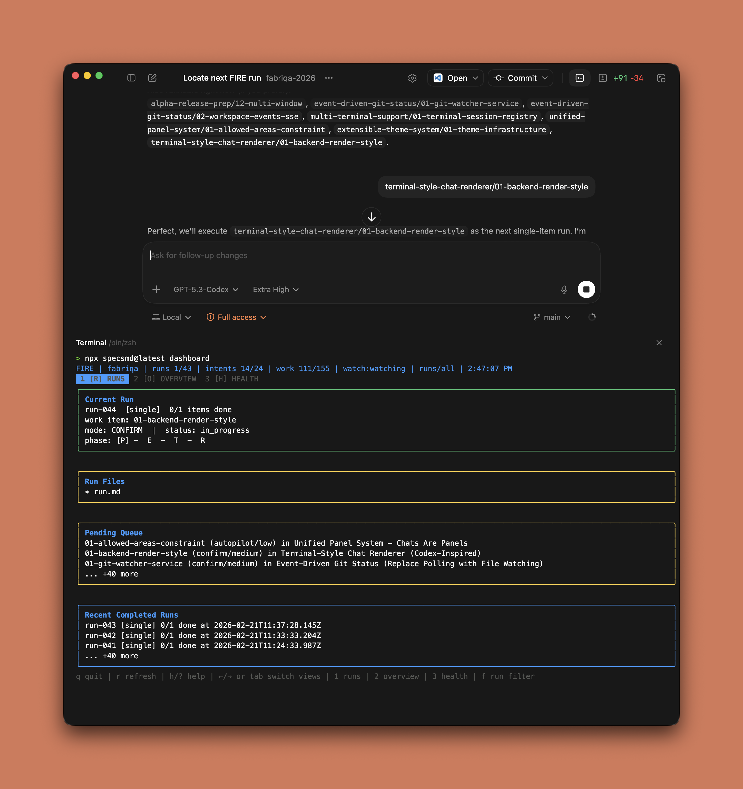
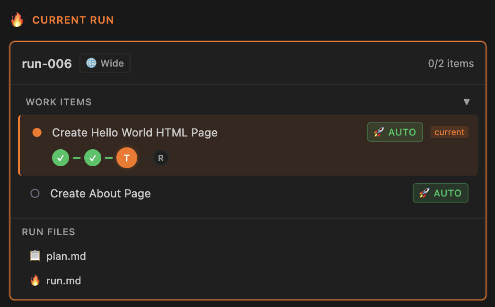
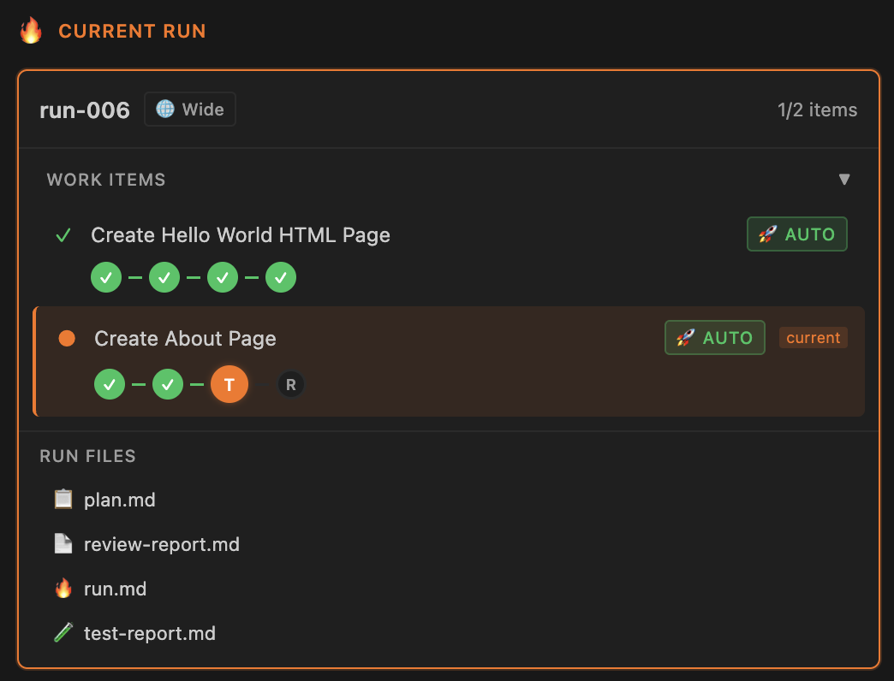

# Changelog

All notable changes to this project will be documented in this file.

The format is based on [Keep a Changelog](https://keepachangelog.com/en/1.1.0/),
and this project adheres to [Semantic Versioning](https://semver.org/spec/v2.0.0.html).

You can also view this changelog at [specs.md/changelog](https://specs.md/changelog).

## [Unreleased]

### Added

- INFERNO: `run.cjs grant <dispatch-id> --path <file>` adds one file to a running dispatch's signed ownership, with the orchestrator as signer. `run.cjs verify-item` reads the grant, so a path granted after dispatch is no longer reported as outside the item's `ownership.editable`, the item spec needs no hand edit, and a correction's fresh `dispatch-log` carries the earlier grants
- INFERNO: `run.cjs plan-lint <intent-id>` checks the plan's form and prints one finding per line, exit 2 on any: a success criterion no item delivers, an item that names none, an Item Map that disagrees with the items, an acceptance criterion without its test in a code span, a missing item section, a `TBD` or `TODO`, and a breaking test outside the item's `ownership.editable`. Two items that share an editable file with no dependency path between them are printed without failing it. `run.cjs frontier` runs the lint before it prints a ready set, and a plan written before numbered success criteria is not linted and builds as before
- INFERNO: `state-transition.cjs defer-item --intent <id> --item <id> --reason "<why>"` takes an item no builder was dispatched on out of a running intent, with one `--rewire <item>=<new-dep>` (or `<item>=none`) per open item that depends on it, changing the ledger and the spec together. A deferred item no longer holds `close-intent`, `check`, the frontier, the reviews or the gate, is never offered for building, and stays in the archived intent with its reason for the next plan, so deferring work no longer means hand-editing `state.yaml`
- INFERNO: a host keeps its rules in `.specs-inferno/standards/`, one file per topic and one rule per heading, listed with the path globs they apply to under `standards:` in `.specs-inferno/config.yaml`. `/specsmd-inferno-standards` (Codex: `$specsmd-inferno-standards`) drafts the folder once from `CLAUDE.md`, `AGENTS.md` and the files they point at for the owner to approve; the planner reads it, `run.cjs dispatch-log` prints a `standards` line for each file that applies to a builder's `ownership.editable`, and a listed file that does not exist refuses the dispatch. The item reviewer no longer carries one host's rules itself (the 500 line ceiling, dashes, suppressions, reader-facing copy), so a host that relies on them moves them into its standards; a host without the folder runs as before
- INFERNO: `run.cjs smoke|windows --accept-intermittent --test "<name>" --reason "<why>" --by <who>` holds a lane's product red when the file named by the new `verification.<lane>.verdicts` key shows every red test green on the base and green on a second walk. `ship` writes the accept into the merge commit as one `exception:` line, and a third accept of the same test waits for a base commit carrying `Fixes-intermittent: <name>`. `run.cjs gate --detach --lane <name>` walks one lane again, also while the gate job still runs
- INFERNO: `mutate.session` in the host config lets the mutants of a batch that run their test through a wrapper syncing the tree to another machine share one session of that wrapper: the tree is copied and the slot taken once per test command, and per mutant only the changed file is sent, tested and put back. The key names the wrapper's `match` pattern and its `open`, `send`, `run` and `close` commands; without it a batch runs as before
- INFERNO: `mutate.sealed` lists files a host seals with a manifest of their digests, each with its `paths` globs and its `reseal` command. `run.cjs mutate` reseals after a mutant lands in one, so the test sees a valid seal, and puts back every path the reseal changed on every exit; `mutate.reseal_seconds` (default 300) bounds one reseal
- Evals: `evals/review-loop/stats.cjs --tree <intent worktree> --base <ref> [--head <ref>]` reads the history of an intent's item review files and prints one line per item and the totals: rounds, fix rounds by kind, later findings, mutants per criterion, survivors, ownership grants and oracle dispatches by route. `evals/review-loop/tokens.cjs --session <transcript dir>` prints tokens, rounds and context per round by agent type
- INFERNO: `/specsmd-inferno-oracle`, a decision subagent pinned to `claude-opus-5-5` at `xhigh` that takes a judgment call a builder, the orchestrator, a planner or a session would otherwise postpone, decides it from the artifact, and returns one decision instead of a menu
- INFERNO: builders return a judgment call as a `blocked` result whose `notes` start `oracle:`, and the orchestrator routes it to the oracle and resumes the same builder with the decision, so a "residual" or a "product call" never leaves a run unanswered
- INFERNO: `state-transition.cjs archive-intent` moves a closed intent's block and directory into `.specs-inferno/archive/`, frees its id from every remaining intent's `depends_on_intents` with one dated line saying why, and with `--sweep` takes every other completed intent along except one another session is still shipping. Finalize gains step 2b, which calls it on the intent branch so the move rides the same merge and push. Until now only `/ship-intent` archived, by hand, so an intent closed by the orchestrator stayed in the live ledger for good: consumer repos were found holding 17 and 81 completed intents in the file a session reads to see what is left to do

### Changed

- INFERNO: the item reviewer no longer runs mutants. In a first review it proposes one mutant per numbered acceptance criterion that a test covers, and `run.cjs review --item` runs them once when it records the review, writes `caught` itself and adds a `major` finding for each survivor, whose fix is a test that turns red, never a change to the production line. A criterion whose test pins reader-facing copy word for word is listed under `pins` and checked by reading instead; a delta review proposes no mutant, and only the survivors run again
- INFERNO: every item and intent review is a fresh reviewer dispatch, and a delta review reads only the fix, from the commit the previous review recorded to HEAD. Each earlier finding is resolved or repeated as written, and a new finding must sit in a file the fix changed and be a `blocker` or a `major`, never a `minor`. A fix that changes a test's assertion no finding called wrong is `major`, and one that switches a test off is a `blocker`
- INFERNO: the review ladder has an end. Each miss, a fix review with a `blocker` or `major` finding or a surviving mutant, moves the item up once and the count never starts over: the warm builder, a fresh escalate builder that names the root cause before it fixes, the oracle, and at the fourth miss a `next user` line that hands the item to the user while every item that does not depend on it keeps building. A fix review with only `minor` findings is no miss: when the correction stays inside the files that review lists, `run.cjs review --item` records the new verdict `settled` and prints the integrate call, and the intent review is told which items settled over which commits
- INFERNO: `run.cjs verify-item` writes a proof per item beside the finalize proofs: each check with its exit, seconds, counts and last 40 lines, the hash of the item's diff, and the test files the item modified or deleted. A line the item adds that switches a test off fails `verify-item` with its file and line. The item reviewer reads that proof instead of rerunning the checks, and an existing test the item modified or deleted without a criterion that changes what it checked is a `major` finding
- INFERNO: a work item spec gains four sections, Edge Cases, Out of Scope, Test Plan and Reuse, and a `delivers:` list, while the brief numbers its success criteria `SC-<n>` and adds an Item Map of the items that deliver each. Builders build every Edge Cases row and Test Plan line test first, and the reviewer checks each Edge Cases row as it checks a criterion
- INFERNO: the plan-time scan is one bounded cross-check. `run.cjs scan --plan <intent-id>` gives each cut of the plan one cross-checker that looks for conflicts, gaps, misreadings, deviations and wrong assumptions inside a budget of tool calls, then runs at most two fix rounds over the earlier findings and what the repair changed, and hands what is still open to the oracle. `run.cjs scan --item <id>` checks one item against the tree its predecessors left, once before its dispatch, and a call that still names `--only wiring` is refused with the call to run
- INFERNO: an oracle ask carries two grades, `impact` and `complexity`, and `run.cjs dispatch-log <intent-id> --tier oracle --impact <grade> --complexity <grade>` routes and logs it and prints the model to spawn. Only an ask graded high on both takes `models.oracle_hard`, everything else `models.oracle`, a host without `models.oracle_hard` routes every ask the normal way, and a normal oracle that returns `blocked` is asked once more on the hard route with `--blocked <dispatch-id>`. No route waits for the user's yes and a headless run routes the same way, which replaces the user's approval before the tier above the oracle
- INFERNO: a run branch keeps the host config it was given. The `--config` that `claim`, `worktree`, `integrate` or `gate` last received on an intent run branch is recorded, and a later `worktree`, `integrate`, `gate`, `green`, `ship` or lane accept on that branch without `--config` uses it instead of falling back to `.specs-inferno/config.yaml`
- AI-DLC Turbo: every acceptance criterion a test covers gets a mutant. `construction.mutants` is now a cap whose default is `all` (an existing number still caps), the story lens lists the criteria no test covers under `untested`, and the mutation run prints one `CRITERION` line per criterion. A criterion with a test and no killed mutant is a `major` finding, and one whose mutant was invalid gets one new proposal in the delta review
- INFERNO: a judgment call climbs a ladder. The thread that meets it decides it when the spec, the code and the primary sources ground one answer. Only a call it cannot decide goes to the oracle, pinned to `claude-opus-5-5` at `xhigh`, and that rung is skipped when the asking thread already runs there. Fable 5.2 sits above it, spawned as the oracle with `model: fable`, only after the user says yes in an AskUserQuestion whose other options are the readings on the table. A headless run never escalates: it writes the question to a halt note and holds only that item. The oracle's `blocked` verdict also covers a call the artifact does not settle, with its recommendation in `decision`
- INFERNO: the test for an intent is the builder's context, not whether one builder could in theory finish the work. A direct build is one small change, or two closely tied ones, that one builder finishes and one session proves with its context still compact. A batch of findings (a hand test, a review, a board of decisions), several cards, or changes across more than one screen, module or concern is an intent, planned as work items of one or two changes each. The planner's triage gains criterion (a) for the batch and drops "there is no size criterion", and `state-transition.cjs check` accepts a reason that opens with `(a)` and no longer lists a batch among the things that name no criterion. This replaces "an intent is the exception" of 2026-09-06. Ruben, 2026-10-21: "als we dit gaan doen met maar 6 builders, is dat hun context heel snel vol gaat lopen. Daarom is Inferno ook opgezet."
- INFERNO: a budget halt in a headless run launches no wait script. The orchestrator's process ends with its turn and would take the wait with it, so the halt section now tells a headless run to end with the `Intent HALTED` readout and leave the wait and the relaunch to the launcher that started it; recovery resumes from the halt note
- INFERNO: the finalize gate folds the base branch in before it runs, so the tree it proves is the tree `ship` merges. Until now the procedure gated first and folded at ship, so every intent whose base moved while it was open paid a second full gate after `ship` found the green marker stale
- INFERNO: `state-transition.cjs check --intent <id>` on an intent already moved to the archive answers "archived" with exit 0 instead of `INTENT_NOT_FOUND`, since finalize runs the check after `archive-intent`
- INFERNO: the finalize gate runs as its own process. `run.cjs gate --detach` starts it and `run.cjs gate --wait` blocks on it in slices that fit a host's per-call cap, exiting 4 while it still runs. A headless run used to start the gate as a background tool call and exit with the turn, which orphaned the gate and left the intent in progress with no readout
- INFERNO: `.specs-inferno/quick-fixes.md` is retired. The planner's intent-worthiness gate used to park single-item work in that file, which nothing reads, so parked entries sat unbuilt while the intents beside them shipped. `state-transition.cjs check` drops the `one-item-intent-without-reason` drift and the `single_item_reason` field, and reports a `quick-fixes.md` beside the ledger as drift instead
- INFERNO: size decides the fix-now box, not category. In the box is one piece of work in about five source files or fewer, proved by one scoped test red before and green after, landing in one commit, whatever lane it sits in. Three exits take a small change out: a file an open work item owns or a change that must land after one, a look decision nobody has made, a regulatory encoding. A value a design source already declares and a file misses is a defect and stays in the box, whatever it does to the pixels, and a finding is routed after it is measured rather than after it is sighted. A one-item intent now carries a `BOX.` line in its entry comment naming the exit it took with the measurement, and `state-transition.cjs check` reports an open one-item intent without that line as drift, so an intent cannot be the default shape for small work. Measured across two consumer ledgers, one-item intents had gone from 17 of 120 to 11 of 33 under the previous text

### Fixed

- INFERNO: `run.cjs integrate` refuses only the uncommitted files it owns or commits, and after the fold those inside the scope of a check it runs, so a reviewed item lands while a sibling builder or reviewer has an uncommitted file elsewhere in the tree. A fold git refuses over an uncommitted file names that file; `gate` keeps its whole-tree refusal
- INFERNO: `run.cjs verify-item` waits only on an open dispatch whose ownership overlaps the item's, or on a change no dispatch claims, instead of on every builder started since the item's baseline
- INFERNO: completing an item no longer commits a review file another reviewer wrote and nobody recorded yet. The ledger commit of `run.cjs integrate` holds only `state.yaml` and the work item files the completion wrote, so that review stays pending instead of reading as owed
- INFERNO: one stale diagnosis probe no longer hides the whole ready set. `run.cjs frontier` replays probes only for ready items with no dispatch and no review, leaves a stale one out of the ready set with an `INVALID` line beside it, and exits 2 only when the stale items are all that could start
- INFERNO: a fold of the base branch no longer re-owes an item's review. The review stands when every commit since it that touched a listed file was a clean fold of the base, or changed a case registry only in blocks a sibling item names; the branch's own change, a fold that conflicts in the item's lines and a change to a block no spec names still re-owe it
- INFERNO: `run.cjs integrate` on the base branch runs its scoped checks again. It diffed the landing against HEAD itself, so a direct build there ran no scoped check; it now diffs from `--since <ref>`, else from `origin/<base>`, and with neither runs every scoped check. `run.cjs doubles` on the base branch counts against `--since` as well
- INFERNO: `run.cjs mutate` reads `caught yes` only when a test summary reports a failure. A red run that never reached a test, such as a refused remote wrapper or a missing binary, reads `no verdict` with its exit code instead of a false catch
- INFERNO: the collect of `run.cjs scan --plan` writes every GAP line to a gaps file and names it in the step it prints, instead of losing the lines past the 30-line printout; a clean collect removes the file
- AI-DLC Turbo: a mutant is killed only when a test failed. A mutant that did not build, parse or collect, ran into the timeout, was ended by a signal, or whose red run reports no failed test reads `invalid` with that reason instead of `killed`

## [0.1.49] - 2026-02-22

### Changed

- Dashboard: Added worktree support in the CLI so you can monitor and switch between multiple branches/worktrees in one place (useful when parallel feature branches are active and you want to track progress without leaving the dashboard)
- Dashboard: Added explicit command-log feedback after switching worktrees so the active context change is immediately visible (for example: `Switched to worktree: <name>`)

## [0.1.26] - 2026-02-21

### Added

- FIRE CLI dashboard: `npx specsmd@latest dashboard` for terminal-native workflow tracking
- Tabbed terminal views (Runs, Overview, Health) designed for small embedded terminal panels
- Keyboard navigation for tabs and filters (`1/2/3`, `Tab`, `←/→`, `f`)
- Current Run-first layout with run status, phase track, and run files section

### Changed

- Dashboard is now optimized for CLI-first and Codex desktop app users as an alternative to the VS Code extension
- Reduced dashboard flicker by avoiding unnecessary re-renders and using calmer fallback refresh behavior
- Improved compact rendering with denser borders/spacing and strict height budgeting for small windows
- Added Nerd Font icon auto-detection with manual override via `SPECSMD_ICON_SET=auto|nerd|ascii`

## [0.1.23] - 2026-02-13

### Fixed

- Codex installer now creates proper skills instead of flat `.md` files that Codex cannot read
- Commands are transformed into `.codex/skills/<name>/SKILL.md` with proper YAML frontmatter

## [0.1.11] - 2026-01-25

### Per-Work-Item Phase Tracking

The VS Code extension now shows real-time phase progress for each work item in FIRE runs. Track exactly where your AI agent is in the Plan → Execute → Test → Review pipeline.

**First work item in Test phase** - completed Plan and Execute, now running tests.

**Progress through multiple work items** - first item completed all phases, second item now in Test phase.

### Added

- VS Code: Per-work-item phase tracking in FIRE flow (Plan → Execute → Test → Review)
- VS Code: Real-time phase progress indicator showing which phase each work item is currently in
- VS Code: Visual distinction between completed phases (green checkmarks) and active phase (orange highlight)

### Changed

- FIRE: Phase tracking now updates at work item level instead of run level for better granularity

## [0.1.10] - 2026-01-24

### Added

- FIRE: Status skill now includes comprehensive integrity validation with 14 issue types
- FIRE: Code verification option to check codebase when work item status is ambiguous
- FIRE: Maintenance log (`maintenance-log.md`) for tracking all automated fixes
- FIRE: Support for multiple parallel active runs in state schema

### Changed

- FIRE: Status skill bumped to v2.0.0 with full validation workflow
- FIRE: All command references now use `/specsmd-fire` prefix consistently
- FIRE: Config references updated from `fire-config.yaml` to `memory-bank.yaml`

### Fixed

- FIRE: Added missing `review-report.md` to run artifacts schema
- FIRE: Added missing `design-doc` path to schema
- FIRE: Added `blocked` status to work item status values
- FIRE: Added `mode` and `depends_on` fields to work item schema
- FIRE: Orchestrator agent state example now matches actual schema structure

## [0.1.9] - 2026-01-23

### Added

- FIRE Flow: New flow type with 17 Lit web components for VS Code extension
- VS Code: Flow switcher in toolbar for switching between AI-DLC and FIRE flows
- VS Code: FIRE Runs tab with active run display and completed runs history
- VS Code: FIRE Intents tab with expandable intent cards and progress tracking
- VS Code: Pending work items grouped by intent with dependency visualization
- VS Code: File watcher for `.specs-fire` directory to auto-refresh on state changes
- VS Code: Expandable completed runs showing all markdown files with click-to-open

### Changed

- File watcher now monitors both `memory-bank` and `.specs-fire` directories

### Fixed

- YAML parsing now supports both snake_case and camelCase field names
- Intent expansion state persisted correctly across view refreshes

## [0.1.8] - 2026-01-13

### Added

- Simple Flow: Lightweight 3-phase workflow (Requirements → Design → Tasks)
- Simple Flow documentation pages
- Changelog page in documentation
- Kiro installer with specs symlink support for Simple Flow

### Changed

- Clarified Simple Flow and AI-DLC as independent flows (not an upgrade path)

### Fixed

- Markdown lint errors in DDD construction bolt template

## [0.1.7] - 2026-01-10

### Fixed

- OpenCode installer now uses correct command directory and frontmatter

## [0.1.6] - 2026-01-10

### Added

- VS Code: Markdown editor selection setting
- VS Code: Clickable stories in bolt widget
- ADR (Architecture Decision Record) tracking with decision index across bolts

### Fixed

- Markdown lint errors in DDD construction bolt template
- Security vulnerabilities in dependencies

## [0.1.5] - 2026-01-09

### Added

- VS Code: Construction log display for completed bolts
- VS Code: Analytics module with lifecycle, engagement, and project metrics tracking
- VS Code: Open VSX marketplace publishing (works with Cursor, Windsurf, etc.)
- VS Code: Enhanced logs inception artifacts

### Changed

- Moved scripts into aidlc flow folder for better organization

### Fixed

- Test paths after scripts reorganization

## [0.1.4] - 2026-01-06

### Added

- Contextual options menu (copy, AI tools, feature request)
- DeepWiki integration for codebase exploration
- Workflow descriptions for Google Antigravity navigation
- SEO metadata and social sharing tags to docs
- Product Hunt launch integration

## [0.1.3] - 2025-12-30

### Added

- Artifacts display in active bolt view
- Manual workflow dispatch trigger for releases
- Dev branch auto-publish workflow

### Fixed

- Bolt-start guardrails to prevent skipping story updates
- Active bolt UI improvements and IDE-agnostic messages
- Frontmatter validation for bolt creation
- Geolocation in Mixpanel analytics tracker

## [0.1.2] - 2025-12-28

### Fixed

- Analytics events now properly sent before process exit

## [0.1.1] - 2025-12-27

### Added

- Mixpanel analytics for installer events
- VS Code extension with bolt visualization and progress tracking
- Dynamic status discovery for specs filter
- Extension marketplace publishing workflow

### Fixed

- Intent matching by combined format in selector
- Markdown lint errors in bolt-plan skill

## [0.1.0] - 2025-12-27

### Added

- Initial release of specsmd
- AI-DLC Flow with 4 agents (Master, Inception, Construction, Operations)
- Memory Bank for persistent project context
- Support for Claude Code, Cursor, GitHub Copilot, and other AI coding tools
- DDD construction bolt type
- Installer with automatic tool detection

---

[0.1.49]: https://github.com/fabriqaai/specs.md/compare/v0.1.47...v0.1.49
[0.1.26]: https://github.com/fabriqaai/specs.md/compare/v0.1.25...v0.1.26
[0.1.23]: https://github.com/fabriqaai/specs.md/compare/v0.1.22...v0.1.23
[0.1.11]: https://github.com/fabriqaai/specs.md/compare/v0.1.10...v0.1.11
[0.1.10]: https://github.com/fabriqaai/specs.md/compare/v0.1.9...v0.1.10
[0.1.9]: https://github.com/fabriqaai/specs.md/compare/v0.1.8...v0.1.9
[0.1.8]: https://github.com/fabriqaai/specs.md/compare/v0.1.7...v0.1.8
[0.1.7]: https://github.com/fabriqaai/specs.md/compare/v0.1.6...v0.1.7
[0.1.6]: https://github.com/fabriqaai/specs.md/compare/v0.1.5...v0.1.6
[0.1.5]: https://github.com/fabriqaai/specs.md/compare/v0.1.4...v0.1.5
[0.1.4]: https://github.com/fabriqaai/specs.md/compare/v0.1.3...v0.1.4
[0.1.3]: https://github.com/fabriqaai/specs.md/compare/v0.1.2...v0.1.3
[0.1.2]: https://github.com/fabriqaai/specs.md/compare/v0.1.1...v0.1.2
[0.1.1]: https://github.com/fabriqaai/specs.md/compare/v0.1.0...v0.1.1
[0.1.0]: https://github.com/fabriqaai/specs.md/releases/tag/v0.1.0
